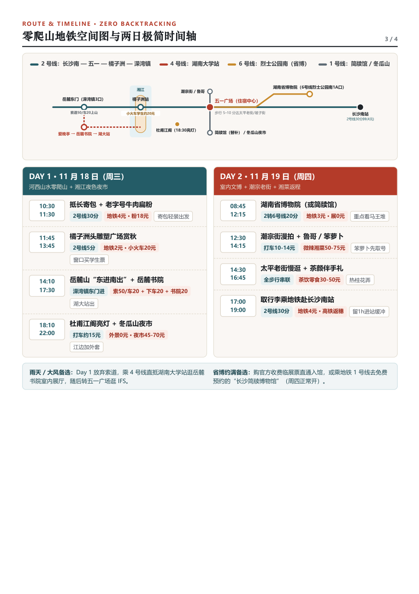

<h1 align="center">travel-guide-planner</h1>

<p align="center">
  <em>全量图文旅游攻略与 4 页少字画册式 PDF 路书规划 Skill</em>
</p>

<p align="center">
  <a href="./VERSION"></a>
  <a href="./LICENSE"></a>
  <a href="./SKILL.md"></a>
</p>

<p align="center">
  简体中文 | <a href="./readmes/README.en.md">English</a>
</p>

> **告别千篇一律的长篇大论与折返跑攻略。**
> 先问清出发地、预算、身份优惠、辣度忌口与不爬山底线，校验时间/体力/空间动线冲突，最终输出 **少字高信噪比、图片主导、含当地特色美食价格矩阵与无折返地图** 的 A4 图文画册路书。

---

## 实测成品效果预览（4 页精简图文 PDF）

以下为使用本 Skill 生成的《长沙 2 天 1 晚秋日慢游图文路书》真实导出页面截图（A4 竖版 `4` 页、非空白正文精简至 `2,294` 字、内嵌 `11` 张景点街区美食图 + SVG 地铁空间拓扑图）：

<table>
  <tr>
    <td align="center" width="50%">
      <br>
      <sub><b>Page 1 · 大图封面 + 可视化预算盘</b>：Hero 全幅季景、4 项核心指标与天气穿搭优惠速算</sub>
    </td>
    <td align="center" width="50%">
      <br>
      <sub><b>Page 2 · 地标与街区视觉图鉴</b>：2×2 景点大图 + 1×3 住宿与街区卡片，价格门票一图看完</sub>
    </td>
  </tr>
  <tr>
    <td align="center" width="50%">
      <br>
      <sub><b>Page 3 · 无折返 SVG 路线图 + 双栏时间轴</b>：地铁线路色标、单向动线与双兜底 Plan B</sub>
    </td>
    <td align="center" width="50%">
      <br>
      <sub><b>Page 4 · 美食价格矩阵 + 行前 4 项速查</b>：实拍美食横幅、微辣点单口诀与防坑热线</sub>
    </td>
  </tr>
</table>

---

## 为什么做这个 Skill

- **绝不未问先排、不预设出发地**：先收集或确认**出发地、目的地、精确抵离时刻、证件优惠（学生证/老人证等）、辣度忌口与体力边界（如不爬山）**，再校验路线、预算与闭馆日冲突。
- **少字、多图、高信噪比**：把动辄四五千字的冗长文字表，压缩成 **视觉与图表占 65%+** 的画册页面——水平预算进度条、SVG 空间拓扑图、单行时间/费用微标签卡片，出门掏手机扫一眼就能走。
- **当地特色美食硬核融入**：拒绝脱离动线的网红榜单，必须覆盖**正餐老店、早餐粉面、茶饮小吃与夜市**，配套美食实拍图、人均/单品价格区间、辣度适配与线上取号提示。
- **内置 PDF 导出与逐页视觉验版闭环**：配套 [export_pdf.py](./scripts/export_pdf.py)（Edge/Chrome Headless + `PyMuPDF`），自动核验页数、非空白字数并渲染逐页 `.png` 供 Agent 目视排查文字重叠、图例粘连与多余尾页。

---

## 30 秒快速安装

### 方式一：使用开放 Agent Skills CLI（推荐）

支持 Antigravity、Claude Code、Codex、Cursor、OpenCode 等主流工具：

```bash
npx skills add CJG0712/travel-guide-planner -g
```

### 方式二：Git 手动安装到对应 Agent 目录

- **Antigravity（全局生效）**：

  ```bash
  git clone https://github.com/CJG0712/travel-guide-planner.git ~/.gemini/config/skills/travel-guide-planner
  ```

- **Claude Code（全局生效）**：

  ```bash
  git clone https://github.com/CJG0712/travel-guide-planner.git ~/.claude/skills/travel-guide-planner
  ```

- **项目级共享**：克隆或复制到项目根目录的 `.agents/skills/travel-guide-planner/`。

---

## 使用方式

安装后直接向你的 AI Agent 发起旅游规划需求即可触发（支持 `/travel-guide-planner` 或自然语言提及“做攻略”“旅游路书”“行程规划”）：

```text
我打算本周六从成都出发去重庆玩 3 天 2 晚，有学生证、不吃辣、不想爬太多山，
预算 2000 元以内，帮我做一份少字、图片多、带当地美食价格的 PDF 路书。
```

### 本地体验模板导出

如需单独测试 HTML 到 4 页 A4 PDF 的渲染与质检脚本：

```bash
pip install -r requirements.txt
python scripts/export_pdf.py --html examples/lookbook-template.html --out tmp/sample.pdf --preview-dir previews --dpi 160
```

> 运行依赖：本机需安装 Microsoft Edge 或 Google Chrome/Chromium 浏览器用于无头 PDF 打印；`PyMuPDF` 与 `python-docx` 为可选辅助依赖（仅用于字数/页数统计、转 PNG 目检或 Word 导出）。

---

## 仓库目录结构

```text
travel-guide-planner/
├── SKILL.md                          # 核心全量技能指令与五阶段工作流
├── README.md                         # 中文说明文档
├── readmes/
│   └── README.en.md                  # English README
├── agents/
│   └── openai.yaml                   # Codex / ChatGPT Agents 适配清单
├── assets/
│   └── demo_page_1..4.png            # 4 页画册式 PDF 真实渲染效果展示图
├── references/
│   ├── itinerary-template.md         # 对话详版与 4 页少字图鉴骨架模板
│   └── visual-pdf-blueprint.md       # 少字视觉画册排版、CSS 与 PyMuPDF 验版蓝本
├── examples/
│   └── lookbook-template.html        # 可直接运行的 4 页 A4 画册 HTML+SVG 样板
├── scripts/
│   ├── export_pdf.py                 # Edge/Chrome Headless PDF 导出与 PNG 质检 CLI
│   └── validate_skill.py             # 包结构、YAML 与内链完整性校验脚本
├── .github/
│   ├── ISSUE_TEMPLATE/               # Issue 反馈与模板建议表
│   └── workflows/validate.yml        # GitHub Actions 自动校验流水线
├── requirements.txt                  # 可选 Python 依赖清单
├── VERSION                           # 版本号
└── LICENSE                           # MIT 开源协议
```

---

## 协议与贡献

- 本项目基于 [MIT License](./LICENSE) 开源；注意可选依赖 `PyMuPDF` 采用 AGPL-3.0 协议（若仅直接阅读 Markdown 或使用浏览器手检 PDF，可跳过安装 `PyMuPDF`）。
- 欢迎通过 Issue 或 PR 贡献更多城市 SVG 路线图、画册样式模板或导出口径优化。
