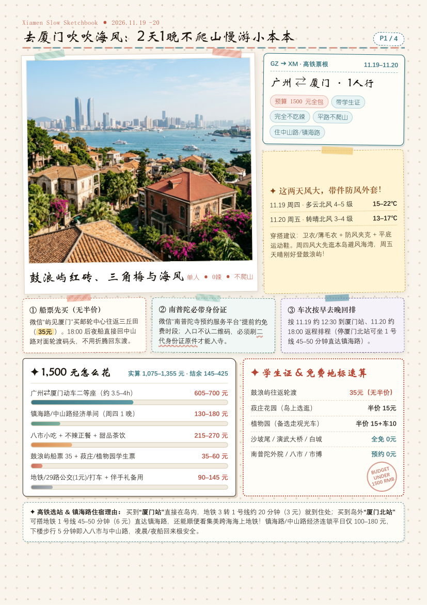
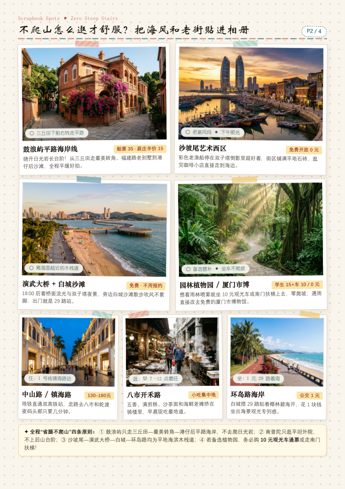
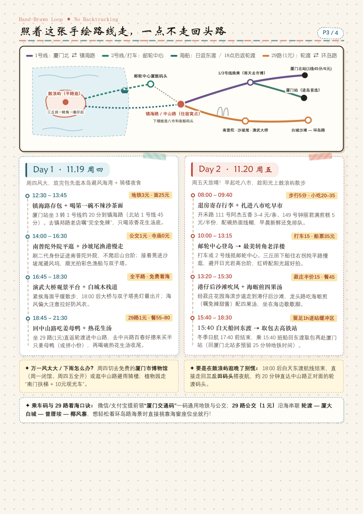
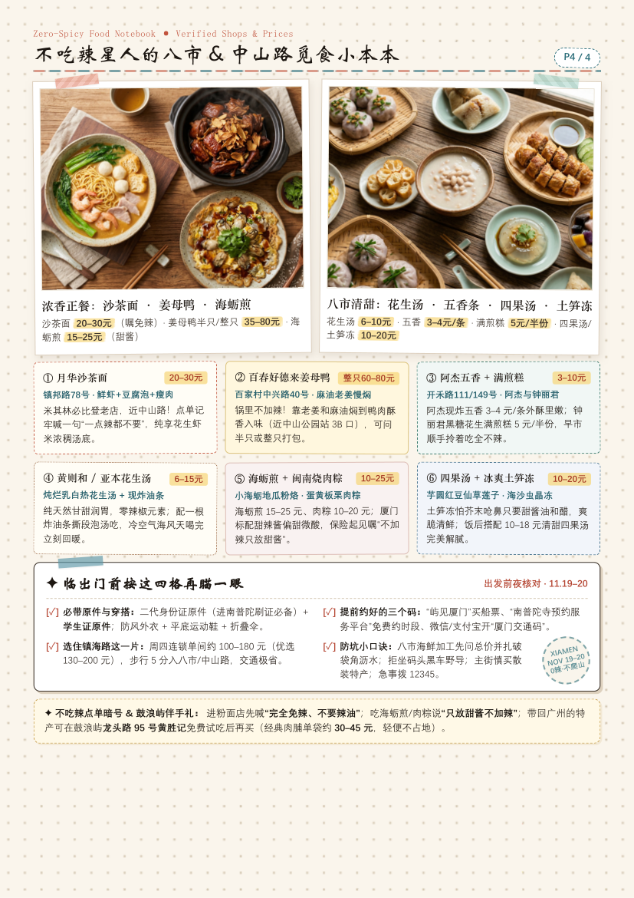

<h1 align="center">travel-guide-planner</h1>

<p align="center">
  <em>City-agnostic, handcrafted travel sketchbook &amp; visual-first A4 PDF itinerary skill</em>
</p>

<p align="center">
  <a href="../VERSION"></a>
  <a href="../LICENSE"></a>
  <a href="../SKILL.md"></a>
</p>

<p align="center">
  <a href="../README.md">简体中文</a> | English
</p>

**travel-guide-planner** is a general-purpose, city-agnostic travel planning skill (never assuming any fixed origin or destination) that transforms trip ideas into authentic, visually driven 4-page A4 travel zines with natural, jargon-free notes.

## Showcase (v1.1.0 Handcrafted Journal Example)

<table>
  <tr>
    <td align="center" width="50%"><br><sub><b>Page 1</b>: Polaroid hero, ticket stub, weather sticky note, crayon budget &amp; hub guide</sub></td>
    <td align="center" width="50%"><br><sub><b>Page 2</b>: Balanced 2×2 &amp; 1×3 Polaroid collage with low-effort walking rules</sub></td>
  </tr>
  <tr>
    <td align="center" width="50%"><br><sub><b>Page 3</b>: Hand-drawn SVG coastal route map, two-column journal timeline &amp; Plan B</sub></td>
    <td align="center" width="50%"><br><sub><b>Page 4</b>: Verified local food addresses/prices, checklist &amp; postmark stamp</sub></td>
  </tr>
</table>

## What's New in v1.1.0

- **Strictly City-Agnostic**: Never presets any departure or destination city; confirms dates, arrival/departure windows, discounts, dietary spice limits, and physical pace (e.g., no hiking) before synthesizing routes.
- **Dual-Source Image Policy (Real Photos First)**: Searches and uses clean, watermark-free real web photographs first; falls back to controlled, reality-grounded image generation only when real photos are unavailable, cluttered, watermarked, or visually inconsistent—strictly forbidding fabricated landmarks or off-diet ingredients.
- **Handcrafted Layout & Crisp Typography**: Replaces stiff AI template phrases and uniform SaaS boxes with dotted notebook paper, tilted Polaroids with washi tape, clear legible sans/calligraphy font pairing, and consistent `gap` vertical rhythm across all 4 A4 pages.
- **Isolated PDF Export QA**: [`scripts/export_pdf.py`](../scripts/export_pdf.py) runs Edge/Chrome headless in an isolated `--user-data-dir` profile and exports `160 dpi` page PNGs for visual inspection.

## Quick Install

```bash
npx skills add CJG0712/travel-guide-planner -g
```

## License

MIT License. See [`LICENSE`](../LICENSE).
